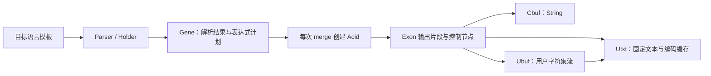

# 命名与执行流程

Meepo 首先是 Dota 英雄，模板复用并生成多个结果的构想借用了其分身能力 Divided We Stand。
包名也延续了英雄技能与特点，而不只是对普通技术词作缩写。
DNA / RNA 的区分表达了静态与动态两个阶段，
Gene / Exon / Acid 表达模板、组成片段与执行环境。理解这些职责，比逐字翻译类名更有帮助。

## 英雄与包名

| 包名 | 名称来源 | 软件职责 |
|:--|:--|:--|
| `bind` | Earthbind | 绑定源码位置、指令与片段 |
| `poof` | Poof | RNA 引擎注册、预热和求值扩展 |
| `sack` | Ransack | 组装模板，保存解析及运行上下文 |
| `pack` | Pack Rat | 收集、打包字符或指定字符集的字节输出 |

`pack` 同时保留“打包”的常用含义，使英雄主题与输出职责相连。
Pack Rat 的名称可见[官方历史更新记录](https://www.dota2.com/patches/7.36)；
包名借用这个名称，不与游戏版本中的具体技能数值或分类绑定。

## 核心名字

| 名称 | 在实现中的含义 | 阶段 / 生命周期 |
|:--|:--|:--|
| `DNA` | 静态替换、原文展开、子模板包含，以及免疫区和作用域管理 | 解析时处理 |
| `RNA` | 变量取值、表达式执行、赋值、循环及条件 | 位置与表达式计划在解析时确定，值与控制流在渲染时求得 |
| `Gene`，基因 | 解析好的模板，含有序片段和所需引擎类型 | 解析完成后重复使用 |
| `Exon`，外显子 | 一个保留的源码片段或指令节点 | `build` 重建源码，`merge` 输出结果，两者用途不同 |
| `Acid`，核酸 | 单次渲染的变量、引擎实例及分支执行状态 | 每次 merge 独立创建并清理 |
| `Life` | 某条替换规则在第几次匹配中生效，如 `1,3-5`、`*` 或命名作用域 | 解析时计数，不是时间或渲染次数 |
| `Tick` | 使用 Life 对模式匹配计数，留下有效替换位置 | 解析时 |
| `Tock` | WHEN/EACH/ELSE/DONE 使用的命名控制组及子片段 | 解析时组树，渲染时协调分支 |
| `Clop` | closed-open，左闭右开的源码区间 `[start, until)` | 字符偏移从 0 开始，诊断行号从 1 开始 |
| `Prc` | processor，对后续文本执行匹配的指令标记 | Parser 的活动规则列表 |
| `Rng` | RNA engine，描述依赖运行时行为的片段；不是 range | 包括没有表达式的动态 ELSE；实际静态缓存判定使用 RngChecker 收集的引擎类型 |
| `Bar` | 需要保留匹配位置缩进的标记 | 解析时确定左边距，输出时应用 |
| `BKB` | Black King Bar，借用 Dota 的免疫概念 | 区域内原文及指令免于处理，直到相应 DNA:END |
| `RnaWarmed` | 已检查、预编译或预解析的表达式计划 | 可复用计划，不存放单次请求值 |
| `RngChecker` | RNA engine checker，缓存同一解析中的引擎及表达式计划 | 解析时 |

变量后缀 `9` 沿用字符缓存的命名，节点的 `text9`、`body9`、`repl9`、`tock9`、`name9` 统一由 `Utxt` 持有固定字符及按需编码的字节。
坐标后缀 `0` / `1` 分别表示包含的起点和不包含的终点。
`edge` 包括目标语言的注释边界，`main` 是其中的指令正文。

例如，`RNA:USE` 本身在解析时匹配文本，然后生成 `TxtRnaUse` 输出节点。
这个输出节点在每次渲染时读取当前变量。因而 WHEN/EACH 的运行时分支不能改变已匹配的源码位置。
同一 `Gene` 可以在不同请求中复用；调用方不应修改其公开子节点，也不应跨请求共享一个 `Acid`。

## 输出与上下文类型

| 类型 | 全称 | 位置 | 职责 |
|:--|:--|:--|:--|
| `Cmap` | context map | `sack` | 复制调用方绑定，覆盖共享函数默认值，需要完整 Map 视图时展开 |
| `Cbuf` | character buffer | `pack` | 用 StringBuilder 收集单次渲染的字符，生成 String |
| `Utxt` | user-charset text | `pack` | 保存固定字符片段，按需缓存目标字符集的编码 |
| `Ubuf` | user-charset output buffer | `pack` | Writer 到 OutputStream 的适配器，使用目标字符集并保留跨片段编码状态 |

短名延续现有风格，类 Javadoc 给出全称、职责、所有权和线程约束。
输出类型归入 `pack`；运行环境映射留在 `sack`，使它与 `Acid` 的关系直观。
`pack` 的实现只依赖 JDK 类型，避免与上层解析器和格式化工具互相依赖。

`Cbuf`、`Ubuf` 每次渲染独立使用；`Utxt` 接收字符数组的所有权，数组之后不可修改。
`Utxt.getBytes(charset)` 默认使用 false，每次生成调用方独占的数组。
`getBytes(charset, true)` 复用最近一种编码的软缓存，返回共享只读数组。
编码通过 Charset.encode(CharBuffer.wrap(chars)) 直接读取原字符数组，复用 JDK 的线程内编码器。
`Dent.write(Writer, Utxt)` 分派普通字符输出与 Ubuf 输出。`Ubuf.write(Utxt)` 判断可复用编码并处理片段边界。Ubuf 单向引用 Utxt。
Utxt.getChars() 返回原字符数组，供跨包批量输出使用，调用方按只读约定共享。
`Utxt` 实现 `CharSequence`，诊断输出直接读取字符，子序列使用 JDK 只读视图。
节点直接保存 `Utxt` 字段，`TxtSimple` 复用继承的 `text9`，`RnaDone.copy` 共享已有的固定文本。
`Exon`、`Tick`、`Tock`、`RnaDone` 提供公开的 String 构造器和 protected Utxt 构造器，分别用于接收模板文本和共享固定文本。
`Ubuf` 持有输出字符集，处理缓存片段的代理对边界。
Encoded 及其中的字符集一起由软引用持有；缓存回收或编码改变后重建，以完整快照安全发布。
输入字符集仅属于 Parser 的解码和 SON 加载上下文，不进入 Gene、Exon 或这些输出辅助类型。
`Ubuf` 对已知无状态编码复用片段字节并处理跨片段代理对；其他编码使用一个连续编码器，以保留 BOM 和状态语义。
char[] 和字符串切片以 CharBuffer 视图传给 CharsetEncoder，完整 String 可使用 JDK 编码快路径。
批量 I/O 缓冲由底层 OutputStream 负责。
`flush` 保留这个待配对字符，`finish` 结束字符序列但不 flush / close 流；`close` 会关闭流。

JMH 基准集中在测试源码的 `jmh` 包，测量口径见 [性能说明](benchmark/optimization.zh.md)。
